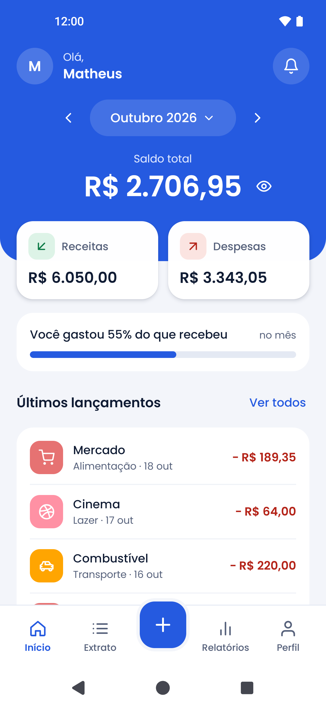
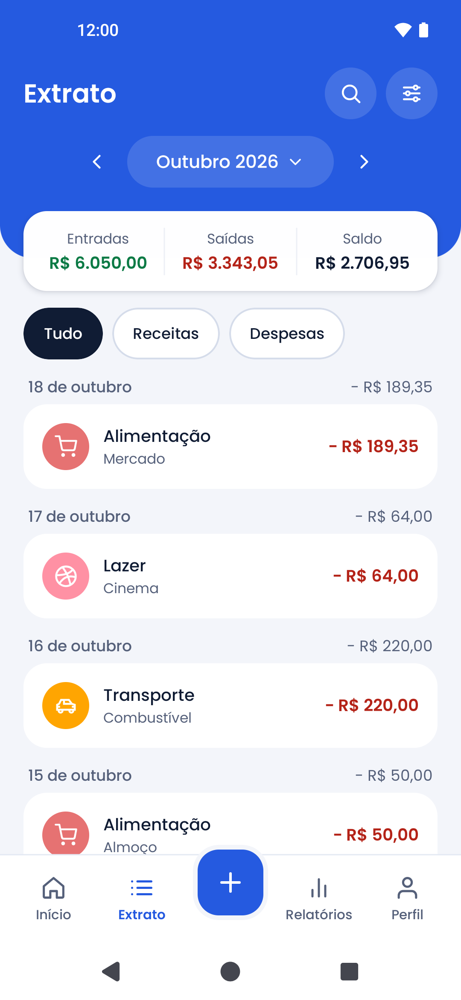
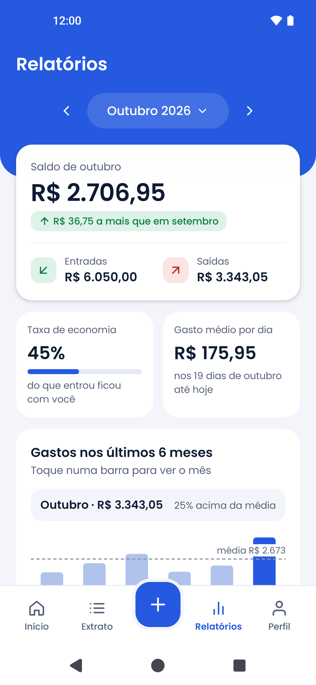
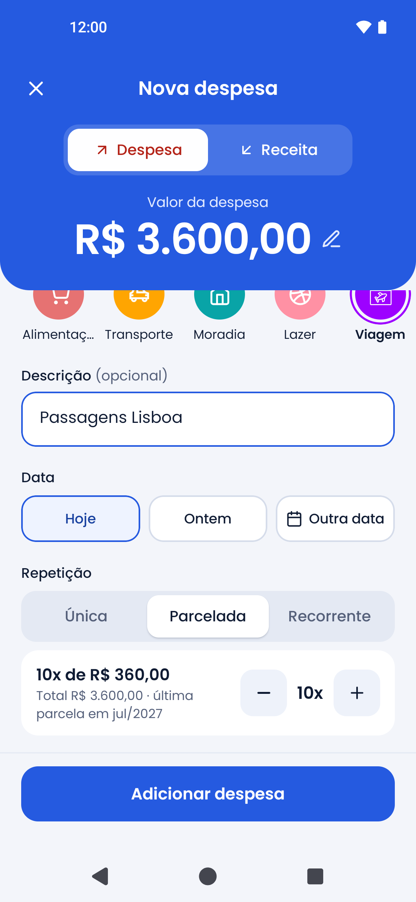
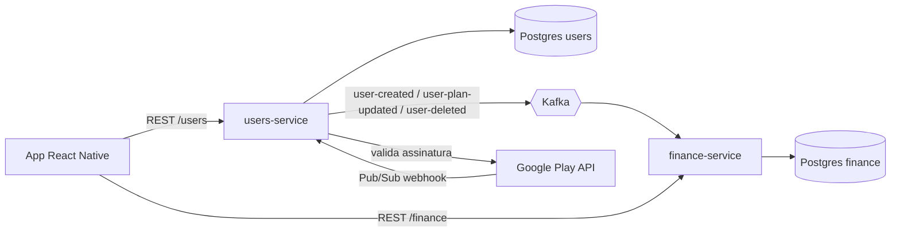

# Money Track

App mobile de finanças pessoais: registre despesas e receitas (com parcelamento e recorrência), organize por categorias, acompanhe o saldo do mês e assine o plano Premium pela Google Play.


<p align="center">
  
  
  
</p>
<p align="center">
  
  
  
</p>

## Funcionalidades

- Cadastro e login com JWT; edição de perfil e troca de senha
- Despesas e receitas com categoria, descrição e data
- Parcelamento (ex.: 3x) em centavos exatos, com edição/exclusão de uma parcela ou do grupo inteiro
- Transações recorrentes (mensais/anuais), com edição/exclusão de "esta" ou "esta e as seguintes"
- Extrato com busca, filtros e paginação; dashboard com gráficos
- Categorias padrão e personalizadas
- Trial de 7 dias e plano Premium via assinatura Google Play
- Exclusão de conta dentro do app (apaga os dados nos dois serviços)

## Arquitetura



Dois microsserviços NestJS, cada um com seu PostgreSQL, sincronizados por eventos Kafka. O `users-service` é a fonte da verdade do usuário e do plano; o `finance-service` mantém uma cópia mínima do usuário para aplicar as regras de plano sem depender do outro serviço.

| Repositório | Papel |
|---|---|
| [`front`](https://github.com/matheus-santos-da-silva/money-track-react-native) | App React Native (Android): Context API, Axios, Reanimated, `react-native-iap` |
| [`users-service`](https://github.com/matheus-santos-da-silva/money-track-user-service) | Contas, autenticação, planos e assinaturas. Publica eventos no Kafka |
| [`finance-service`](https://github.com/matheus-santos-da-silva/money-track-finance-service) | Categorias, despesas, receitas, recorrência e extrato. Consome eventos do Kafka |
| [`money-track-infra`](https://github.com/matheus-santos-da-silva/money-track-infra) | Configuração de deploy (Docker Compose, Caddy e pipeline do GitHub Actions) |

Este repositório reúne os quatro como submodules, com os composes de desenvolvimento e a documentação.

## Destaques técnicos

- **Eventos idempotentes e independentes da ordem.** Os consumers usam `upsert` e chegam ao mesmo estado em qualquer ordem de entrega. Erros são classificados em permanentes (vão direto para a DLQ) e passageiros (retry com backoff): [`is-transient-error.ts`](https://github.com/matheus-santos-da-silva/money-track-finance-service/blob/main/src/infra/kafka/dead-letter/is-transient-error.ts), [`with-retry-and-dlq.ts`](https://github.com/matheus-santos-da-silva/money-track-finance-service/blob/main/src/infra/kafka/dead-letter/with-retry-and-dlq.ts).
- **Parcelamento em centavos exatos.** R$ 100 em 3x = 33,34 + 33,33 + 33,33, com ajuste ao fim do mês nas datas e todas as parcelas gravadas numa única transação: [`installments.ts`](https://github.com/matheus-santos-da-silva/money-track-finance-service/blob/main/src/shared/transactions/installments.ts).
- **Recorrência gerada sob demanda.** As ocorrências são criadas ao consultar o período, sem job agendado, de forma idempotente (índice único impede duplicatas em requisições simultâneas): [`materialize-recurrences.service.ts`](https://github.com/matheus-santos-da-silva/money-track-finance-service/blob/main/src/application/services/materialize-recurrences.service.ts), [`recurrence.ts`](https://github.com/matheus-santos-da-silva/money-track-finance-service/blob/main/src/shared/transactions/recurrence.ts).
- **Extrato com paginação por cursor**, filtros combináveis e totais por dia: [`statement-repository.ts`](https://github.com/matheus-santos-da-silva/money-track-finance-service/blob/main/src/infra/database/repositories/statement/statement-repository.ts).
- **Assinatura validada no servidor.** A compra é confirmada na Google Play API e cancelamentos chegam por webhook Pub/Sub; o plano nunca é decidido pelo app: [`validate-purchase-use-case.ts`](https://github.com/matheus-santos-da-silva/money-track-user-service/blob/main/src/application/use-cases/validate-purchase-use-case.ts), [`handle-google-play-webhook-use-case.ts`](https://github.com/matheus-santos-da-silva/money-track-user-service/blob/main/src/application/use-cases/handle-google-play-webhook-use-case.ts).
- **Datas como dia de calendário.** O app envia `AAAA-MM-DD` e o servidor grava às 12:00 UTC, eliminando bugs de fuso horário: [`date-only.ts`](https://github.com/matheus-santos-da-silva/money-track-react-native/blob/main/src/utils/date-only.ts).
- **Segurança.** Login com tempo constante para não revelar e-mails cadastrados, rate limit atrás de proxy com IP real do cliente e conta somente leitura quando o trial expira (excluir continua permitido).

## Decisões e trade-offs

Para o porte deste app, um monolito modular bastaria. A separação em microsserviços foi uma escolha consciente para estudar mensageria, consistência eventual e deploy independente, com os custos assumidos (cópia de dados entre serviços, regra de plano duplicada, mais infraestrutura). Em um produto real, eu começaria com um monolito modular e extrairia serviços só quando houvesse necessidade concreta.

## Rodando localmente

Pré-requisitos: Docker Desktop, Node 20+, JDK 17 e Android SDK com um emulador (ou aparelho).

```bash
git clone --recurse-submodules https://github.com/matheus-santos-da-silva/money-track.git
cd money-track

# Credenciais dos bancos de dev (arquivo não versionado)
cp .env.example .env

# Backend completo: Kafka + 2 bancos + 2 serviços com hot reload
docker compose -f docker-compose.dev.yml up --build
```

Os serviços sobem em `localhost:3002` (users) e `localhost:3001/finance` (finance); migrations e seed rodam sozinhos.

```bash
# Front
cd front
cp .env.example .env     # emulador: USERS_SERVICE_URL=http://10.0.2.2:3002
                         #           FINANCE_SERVICE_URL=http://10.0.2.2:3001/finance
npm install
npm start                # Metro
npm run android          # em outro terminal
```
## Documentação

- [Arquitetura](docs/ARCHITECTURE.md): serviços, eventos Kafka, modelo de dados, regras de plano